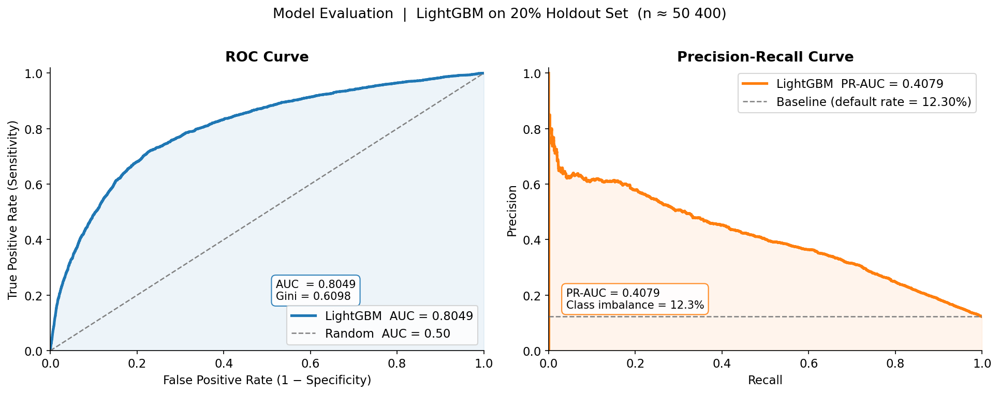
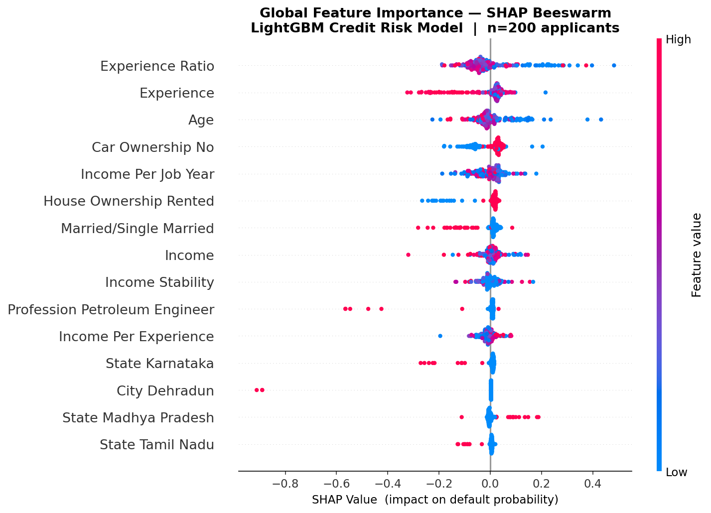
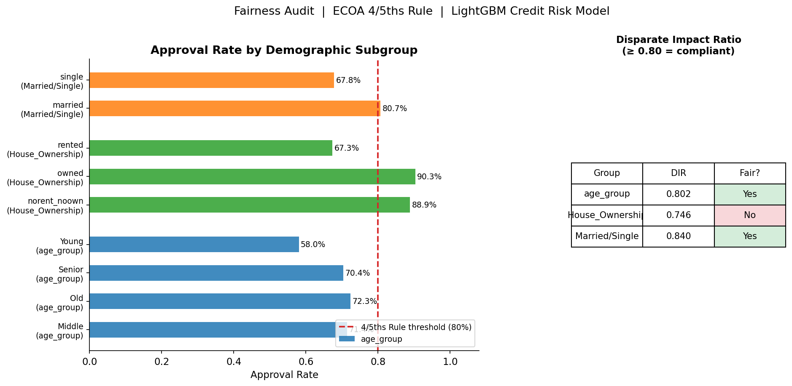

# CrediSense AI

A **Credit Risk Scoring System prototype** with a machine learning pipeline, explainability and fairness analysis tools, a regulatory document assistant, and experimental streaming and feature-store components.

> **Use limitation:** This repository is a demonstration and is not validated or approved for real credit underwriting. Its sample metrics, fairness outputs, regulatory references, and controls do not establish legal compliance or production readiness. Review the [model card](docs/MODEL_CARD.md) before using outputs.

**Live App:** https://credisense-ai-uzzvdsxuuxdbocfwxhmqcc.streamlit.app/


---

## Existing model artifacts

### ROC-AUC & Precision-Recall Curves



The repository includes a model evaluation image and a separate dataset analysis. Treat these as historical artifacts, not current release metrics. Training now writes a hash-linked holdout report, but the split is random rather than temporal and does not prove production generalization. Do not infer production performance from the image.

### SHAP Global Feature Importance



The SHAP plot is an exploratory visualization of one model artifact. Feature attributions describe model behavior; they do not establish causal effects or prove that a decision is appropriate.

### Fairness analysis (screening only)



The image shows exploratory subgroup metrics for selected proxy attributes. These checks do not determine legal compliance, cover every protected group, or rule out individual or systemic harm. A qualified review using the applicable jurisdiction, representative data, and approved methodology is required before any real use.

---

## Capabilities in this prototype

| Capability | Implementation |
|---|---|
| ML Model | LightGBM, hyperparameter tuning, class imbalance handling |
| Explainability | Interactive Plotly SHAP drivers and dependence views, per-applicant reasoning, and labelled subgroup screening |
| AES-256 Encryption | Field-level encryption with PBKDF2 key derivation (cryptography library) |
| PII Handling | Some masking and hashing helpers; full data lifecycle controls are not implemented |
| Fairness Analysis | Exploratory subgroup metrics and disparate impact screening |
| Regulatory References | Checklists and source-document retrieval; no legal compliance certification |
| **Regulatory RAG Copilot** | **Prototype LangGraph + ChromaDB document retrieval with citations for human review** |
| **Adverse Action (RAG)** | **Demonstration notices and retrieved reference passages; outputs require legal review** |
| Credit Bureau Interface | CIBIL/Experian aggregator (mock + live API ready) |
| Model Registry | S3-compatible cloud storage (AWS/MinIO) with local JSON fallback |
| Confidence Intervals | Bootstrap 95% CI on every prediction |
| Drift Monitoring | PSI (score) + CSI (feature) with auto-alerts |
| Human-in-the-Loop | Auto-queue borderline cases, analyst resolve UI |
| Shadow Mode | Champion vs challenger model comparison |
| Prometheus Metrics | /metrics endpoint with 6 custom metrics for Grafana |
| Alerting | Webhook (Slack/Teams/Discord) + SMTP email |
| REST API | FastAPI, Pydantic v2 validation, Swagger docs, async ready |
| Batch Processing | Up to 500 applicants per API call |
| Containerization | Docker + docker-compose |
| CI/CD | GitHub Actions with pytest unit + integration tests |
| Live Data | World Bank API + RBI repo rate + RSS news feeds |
| Stress Testing | Scenario analysis (recession, rate hike, income shock) |
| PDF Reports | ReportLab with CI, explanation, adverse notice |
| Point-in-Time Features | Feast feature views for utilization, payment velocity, and debt-to-income |
| Streaming Ingestion | Kafka application consumer with PostgreSQL audit and Redis cache before offset commit |

### Streaming and Feature Store

The Feast repository is configured by `feature_store.yaml`; definitions live in
`feature_repo/features.py` and are exposed to the root-level Feast CLI through
`features.py`. Supply timestamped rows in
`data/credit_feature_events.parquet` with applicant identifiers, hashed PAN,
feature values, `event_timestamp`, and `created_timestamp`. Historical retrieval
uses Feast `get_historical_features`, which joins only feature events visible at
each entity timestamp. Retrieval enables `filter_by_created_timestamp=True`, so
late-arriving corrections created after the application timestamp cannot leak
into earlier training rows. The configured online store uses Redis at
`localhost:6379` by default.

The Streamlit **Feature Streaming** page (`8_Feature_Streaming.py`) provides
interactive Plotly timelines and latest-value comparisons by applicant. It reads
the local Feast parquet history, accepts CSV/Parquet uploads, or loads live Kafka
feature history from the authenticated `GET /api/v1/features/events` endpoint.
The API reads sanitized fields from `loan_application_audit` in PostgreSQL.
Configure Streamlit secrets `CREDISENSE_LIVE_FEATURES_URL` (for example,
`https://your-api-host/api/v1/features/events`) and
`CREDISENSE_LIVE_FEATURES_TOKEN` (the API key). Synthetic preview data must be
selected explicitly. Create a synthetic local Feast parquet file with
`python scripts/generate_demo_feature_events.py`.

Run `dotenv -f .env run -- feast apply` before first use, then
`dotenv -f .env run -- python -m src.streaming.kafka_consumer` to consume
`credit.applications.v1`. Configure `KAFKA_BOOTSTRAP_SERVERS`, `DATABASE_URL`
(PostgreSQL), `REDIS_URL`, `FEAST_REDIS_CONNECTION_STRING`, and a high-entropy
`PAN_HASH_SECRET`. Create the
`loan_application_audit` table from `db/schema.sql`. Each message is audited
with raw PAN removed, then its features are written to Redis; its Kafka offset
is committed only when PostgreSQL audit and all Feast Redis online view writes
succeed. Processing is idempotent by `application_id` in PostgreSQL, and a
Redis timestamp guard keeps late feature events from regressing the online
snapshot. Compose applies the Feast repository before starting the consumer.
The root `features.py` shim is needed because Feast CLI discovers definitions
from the configured repository root.

For the broader engineering workflow, see [the runbook](docs/RUNBOOK.md),
[the data contract](docs/DATA_CONTRACT.md), and [the model card](docs/MODEL_CARD.md).
Generate synthetic Feast input with `python scripts/generate_demo_feature_events.py`.
For local services, copy `.env.example` to `.env` and run `docker compose up -d postgres redis kafka`;
PostgreSQL initializes `db/schema.sql` on first volume creation. Run `pytest tests -q`
for the full test suite.

### Heterogeneous R-GCN risk signals

`src/gnn_risk.py` defines `applicant`, `employer`, `address`, and `phone_hash`
nodes and a two-layer `HeteroConv` model built from relation-specific R-GCN
convolutions. It predicts a default probability and a syndicate-risk score.
The graph includes the required `employed_at`, `shares_address`, and `co_signed`
relations, plus reverse edges and optional `shares_phone` edges so phone-hash
nodes can participate in message passing. Training uses `applicant_id` (or `Id`),
`employer_id`, `address_id`, hashed `phone_hash`, and
`co_signed_applicant_id`. Missing employer/address links stay unconnected;
occupation and city are not treated as shared employers or addresses. Phone
values must already be hashed.

Install the optional stack with `pip install -r requirements-gnn.txt`, configure
`NEO4J_URI`, `NEO4J_USERNAME`, `NEO4J_PASSWORD`, and `NEO4J_DATABASE`, then run
`python scripts/train_gnn_credit.py`. The CLI writes a checkpoint to
`artifacts/gnn_credit.pt` and writes `rgcn_embedding`,
`rgcn_default_probability`, `rgcn_syndicate_risk_score`, and model metadata onto
Neo4j `:applicant` nodes. Use `--skip-neo4j-write` to train without exporting.
If no `Syndicate_Risk` label exists, the auxiliary target is the observed
default fraction among linked applicants; it is a weak training target, not a
validated syndicate-default label. With no relationship data, applicants are
unlinked and the auxiliary target falls back to the training-set default rate;
provide verified relationship IDs for meaningful graph predictions.

Add the stable internal `applicant_id` to API requests to retrieve stored graph
scores. `/predict` returns them beside (and separately from) LightGBM's decision
probability; `/explain` returns the graph signal alongside the LightGBM SHAP
drivers. The RAG agent includes the signal as attribution context, not as a
standalone adverse-action reason. Graph probabilities are uncalibrated model
outputs and require temporal, out-of-sample, subgroup, and governance validation
before influencing credit decisions.

---

## Regulatory RAG Copilot

The Chatbot page's **Regulatory Copilot** tab is a retrieval-augmented assistant built with LangGraph and ChromaDB. Every returned factual or regulatory assertion must cite a retrieved Chroma chunk as `[chunk:<chunk_id>]`; unsupported claims, citations to chunks outside the current retrieval, and statutory limits absent from the cited text route to a neutral fallback response. The graph nodes, Chroma hybrid retrieval/reranking, and API credit-risk score calls emit OpenTelemetry spans. Configure an OpenTelemetry SDK/exporter in the host service to export spans.

Guardrails validate evidence against the retrieved context. They do not verify that the bundled seed clauses reproduce current primary law. Treat the seed corpus as a development source and review it against official RBI and India Code publications before production use; have qualified compliance counsel verify legal conclusions.

Run the 50-query RAGAS audit with an evaluator API key:

```bash
pip install -r requirements-rag-eval.txt
OPENAI_API_KEY=... python -m eval.ragas_suite --output eval/reports/ragas_audit.json
```

The JSON report includes Context Precision, Context Recall, Faithfulness, and Answer Relevancy summaries and per-query output. Scores measure the copilot against `src/rag_ingest.py`'s seed text; they are not a statutory accuracy certification.

```
Analyst Query / Rejected Application
          │
          ▼
   [intent_router]          keyword classifier — no LLM call needed
          │
          └─► [retrieve_clauses] ──► [generate] ──► [validate_response]
                                                       │             │
                                            cited claim passes   [guardrail_fallback]
                                                       └──────► final response
          ▼
   ChromaDB (semantic candidates + lexical fusion)
          │
          ▼
   cross-encoder/ms-marco-MiniLM-L-6-v2  (rerank → top-5)
          │
          ▼
   GPT-4o-mini  ›  Groq Llama-3.1  ›  template fallback (no API key needed)
```

**Knowledge base** (built-in seed — no PDF download required to run):

| Source | Clauses |
|--------|---------|
| RBI Master Direction on IT Framework (2023) | §§ 2.1, 3.1, 4.2, 5.1, 6.3, 7.1, 8.2, 9.1, 10.4 |
| Digital Personal Data Protection Act 2023 | §§ 4, 6, 8, 9, 11, 12, 14, 16 |
| ECOA Regulation B (12 CFR 1002) | §§ 1002.5(b), 1002.6, 1002.9(a), 1002.9(b) |
| Fair Credit Reporting Act (15 U.S.C. § 1681) | §§ 604, 611, 615(a), 615(b) |

Drop additional PDFs into `data/regulatory_docs/` and run:
```bash
python -m src.ingest_regulations          # ingest all PDFs + seed
python -m src.ingest_regulations --stats  # chunk counts by source
python -m src.ingest_regulations --test "adverse action notice requirements"
```

**Fallback behavior:**

> **Analyst:** Does the available source establish a deadline that was not retrieved?
>
> **Copilot:** I can’t provide a regulatory conclusion because the available retrieved sources did not verify every claim. Please narrow the question to a cited source or have Compliance review the source material.
>
> *📚 4 regulatory clauses retrieved · Relevance scores: 0.847, 0.791, 0.743, 0.698*

---

## Pages

| Page | What it does |
|------|-------------|
| Stress Testing | Scenario analysis — recession/rate hike/income shock portfolio impact |
| Model | Predict + 95% CI + what-if + evaluation + model comparison + live macro context |
| Explainability | SHAP beeswarm/waterfall/dependence/interaction heatmap + fairness audit (DIR) |
| Chatbot | Risk Prediction tab + **Regulatory RAG Copilot tab** (cited compliance Q&A) |
| Logs | Usage logs, feedback, audit trail, cost-benefit tracker, drift monitor |
| Operations | HITL queue, PSI/CSI drift, shadow mode, model registry, alert setup |
| Compliance | RBI IT Framework, DPDP Act 2023, AES-256 status, bureau interface, Prometheus |

---

## Security Architecture

```
Applicant Data
      │
      ▼
Pydantic v2 Validation  ←── Type + range + logic checks
      │
      ▼
PII Masking Engine  ←── Buckets + SHA-256 (raw values never stored)
      │
      ▼
AES-256-GCM Encryption  ←── Field-level encryption before DB write
      │
      ▼
SQLite / PostgreSQL  ←── Encrypted ciphertext at rest
      │
      ▼
SHA-256 Audit Trail  ←── Input hashes, event log, user hashes
```

**Key env vars for security:**
```
ENCRYPTION_KEY=<64-char-hex>       # AES-256 field encryption
API_SECRET_KEY=<strong-random>     # API authentication
S3_BUCKET=<bucket-name>            # Cloud model registry
CREDIT_BUREAU_API_KEY=<key>        # Live CIBIL/Experian
PROMETHEUS_ENABLED=true            # Metrics endpoint
```

---

## Regulatory and fairness review

| Capability | Status |
|---|---|
| Regulatory references | Checklists and document retrieval; not a compliance determination |
| Adverse-action examples | Demonstrations only; require qualified legal review |
| Fairness metrics | Exploratory subgroup screening; not proof of fairness |

---

## Model performance

The stored charts and historical analysis are not current performance claims.
`python -m src.train` generates an ignored report at
`reports/generated/model_evaluation.json` with data and model hashes, a prior
baseline, calibration, threshold metrics, bootstrap intervals, and exploratory
subgroup results. Its stratified random split is not temporal validation; see
the [model card](docs/MODEL_CARD.md).

---

## Business Impact

**Financial Model (1000 apps/month, ₹5L avg loan, 12% default rate, 60% LGD):**
- Without model: ₹3.6 Cr/month expected loss
- With model (85% recall): ~₹3.06 Cr/month savings
- **Annual savings: ~₹36 Cr** on 1000 apps/month portfolio

---

## Project Structure

```
credisense-ai/
├── api/main.py                    # FastAPI: predict/batch/explain/feedback/metrics
├── app/
│   ├── app.py                     # Landing page with system status
│   └── pages/
│       ├── 1_Stress_Testing.py
│       ├── 2_Model.py
│       ├── 3_Explainability.py    # SHAP + Fairness
│       ├── 4_Chatbot.py           # Risk Prediction + Regulatory RAG Copilot
│       ├── 5_Logs.py
│       ├── 6_Operations.py        # HITL + Drift + Shadow + Registry
│       └── 7_Compliance.py        # RBI/DPDP/Encryption/Bureau/Prometheus
├── src/
│   ├── config.py                  # All env-var config (no hardcoded secrets)
│   ├── encryption.py              # AES-256-GCM + PII masking engine
│   ├── compliance.py              # RBI IT + DPDP + credit bureau aggregator
│   ├── rag_ingest.py              # ChromaDB ingest: PDF parsing + seed knowledge base
│   ├── rag_retriever.py           # Bi-encoder retrieval + cross-encoder reranker
│   ├── rag_agent.py               # LangGraph agent: intent router → retrieve → generate
│   ├── ingest_regulations.py      # CLI: python -m src.ingest_regulations
│   ├── metrics_server.py          # Prometheus integration
│   ├── model_registry.py          # S3-compatible registry + local fallback
│   ├── database.py                # SQLite persistence
│   ├── schemas.py                 # Pydantic v2 strict schemas
│   ├── drift_monitor.py           # PSI + CSI
│   ├── fairness.py                # Subgroup metrics + DIR
│   ├── hitl_queue.py              # Human-in-the-loop queue
│   ├── shadow_mode.py             # Champion vs challenger
│   ├── alerts.py                  # Webhook + email
│   ├── adverse_action.py          # ECOA/FCRA notices (plain + RAG-cited)
│   ├── confidence_intervals.py    # Bootstrap CI
│   ├── report.py                  # PDF reports
│   ├── stress_test.py             # Scenario testing
│   ├── evaluate.py                # AUC/Gini/KS/PR-AUC/calibration
│   ├── live_data.py               # World Bank + RBI + RSS
│   └── validation.py              # Input validation + audit
├── data/
│   └── regulatory_docs/           # Drop RBI/DPDP/ECOA/FCRA PDFs here for ingestion
│       └── README.md              # Expected filenames + download sources
├── tests/
│   ├── test_pipeline.py
│   └── test_api.py
├── infra/
│   └── grafana_dashboard.json     # Pre-built Grafana dashboard
├── db/schema.sql                  # Reference PostgreSQL schema
├── Dockerfile
├── docker-compose.yml
├── requirements.txt               # Streamlit + RAG dependencies
└── requirements-api.txt           # FastAPI + infra dependencies
```

---

## Run Locally

```bash
pip install -r app/requirements.txt
streamlit run app/app.py

# FastAPI + Prometheus
pip install -r requirements-api.txt
PROMETHEUS_ENABLED=true uvicorn api.main:app --reload --port 8000
# Swagger: http://localhost:8000/docs | Metrics: http://localhost:8000/metrics

# Docker
docker-compose up

# Ingest regulatory PDFs into ChromaDB (seed knowledge loads automatically on first run)
python -m src.ingest_regulations
python -m src.ingest_regulations --stats
python -m src.ingest_regulations --test "adverse action notice requirements"
```

---

## Environment Variables

```bash
# Security
ENCRYPTION_KEY=<64-char-hex>        # AES-256 field encryption
API_SECRET_KEY=<strong-random>       # API auth key

# Cloud Model Registry (optional — uses local fallback)
S3_BUCKET=credisense-models
AWS_ACCESS_KEY_ID=<key>
AWS_SECRET_ACCESS_KEY=<secret>
AWS_DEFAULT_REGION=ap-south-1
S3_ENDPOINT_URL=<for MinIO/Azure>

# Credit Bureau (optional — mock mode by default)
CREDIT_BUREAU_API_KEY=<key>
CREDIT_BUREAU_URL=https://api.cibil.com/v1
BUREAU_MOCK=false

# Monitoring
PROMETHEUS_ENABLED=true

# Alerting
ALERT_WEBHOOK_URL=https://hooks.slack.com/...
ALERT_EMAIL=ops@yourbank.com
SMTP_USER=alerts@yourbank.com
SMTP_PASS=<app-password>

# RAG Copilot — LLM backend (optional — template fallback works without these)
OPENAI_API_KEY=<key>                 # GPT-4o-mini (primary)
GROQ_API_KEY=<key>                   # Llama-3.1-8B-instant (secondary)

# Optional live application source for the Explainability page (GET JSON endpoint)
CREDISENSE_LIVE_APPLICATIONS_URL=https://your-service/applications
CREDISENSE_LIVE_APPLICATIONS_TOKEN=<bearer-token>
```

---

## Deploy to Streamlit Cloud

The multi-page Streamlit app entry point is `app/app.py`. The app-specific
`app/requirements.txt` keeps Community Cloud's UI environment focused; it
includes Plotly and the optional regulatory copilot stack, while backend-only
Feast/Kafka/PostgreSQL and RAGAS dependencies remain in the root requirements.
The app uses Plotly for interactive charts throughout its dashboard. The
Explainability page scores uploaded CSVs, recent predictions logged by the app,
or records fetched from an optional live JSON endpoint. It computes a SHAP
reason and a human-review recommendation for each scored row, and provides an
upload template. CSVs require `Income`, `Age`, and `Experience` in the model's
normalized 0–1 input scale. Optional columns such as `House_Ownership`,
`Married/Single`, and tenure improve the explanation. The page can screen
subgroup metrics only when an observed `Risk_Flag` label is present. The
Feature Streaming page supports Feast parquet history, CSV/Parquet uploads, and
live Kafka feature history through the authenticated API; synthetic preview data
is opt-in.

To deploy or update it, connect the public repository
`SumedhPatil1507/crediSense-ai` in Streamlit Community Cloud and select branch
`main` with entry point `app/app.py`. Once the app is connected, commits pushed
to its tracked GitHub branch trigger an app update. The existing app URL is
[CrediSense AI on Streamlit](https://credisense-ai-uzzvdsxuuxdbocfwxhmqcc.streamlit.app/).

Add secrets in Streamlit Cloud → Manage App → Settings → Secrets.

The RAG Copilot runs without any LLM API keys using the built-in template fallback and seed knowledge base. To enable cited LLM answers, add `OPENAI_API_KEY` or `GROQ_API_KEY` to Streamlit secrets.

---

## Citations

- Dataset: https://www.kaggle.com/datasets/subhamjain/loan-prediction-based-on-customer-behavior
- LightGBM: https://papers.nips.cc/paper/2017/hash/6449f44a102fde848669bdd9eb6b76fa-Abstract.html
- SHAP: https://papers.nips.cc/paper/2017/hash/8a20a8621978632d76c43dfd28b67767-Abstract.html
- RBI IT Framework: https://www.rbi.org.in
- DPDP Act 2023: https://www.meity.gov.in/data-protection-framework
- Basel II: https://www.bis.org/publ/bcbs128.htm
- World Bank: https://data.worldbank.org
- LangGraph: https://github.com/langchain-ai/langgraph
- ChromaDB: https://docs.trychroma.com
- Sentence Transformers: https://www.sbert.net
